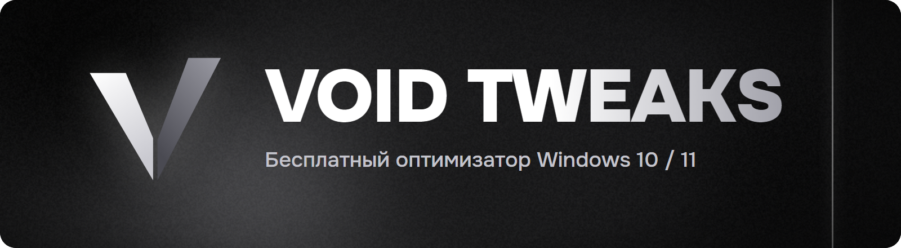
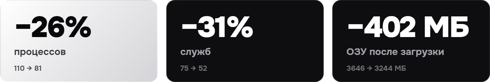
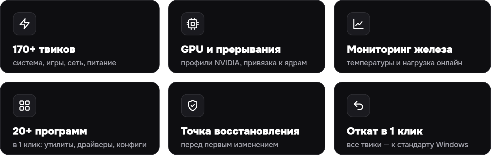
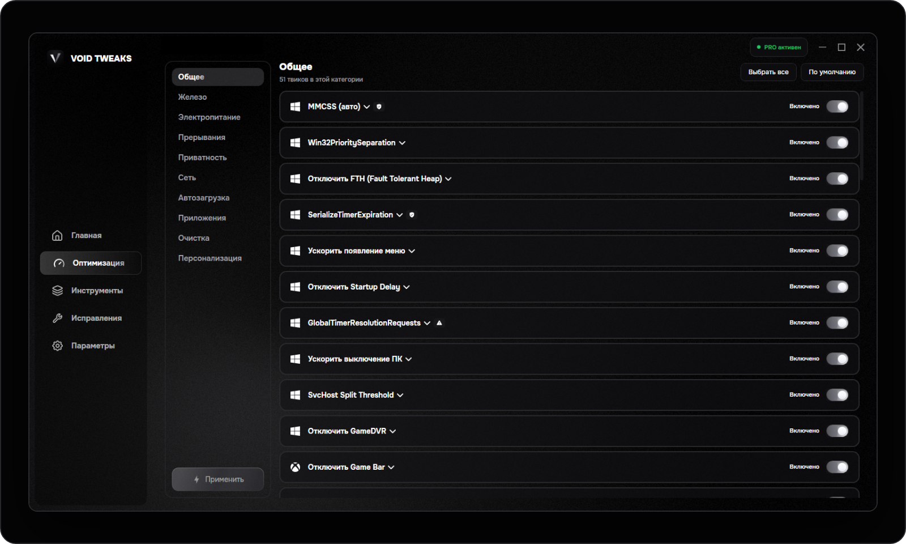

  

&nbsp;
&nbsp;

 

 

[Русский](README.md) · **English**

**Official website: [VOIDTWEAKS — Windows 10/11 optimizer](https://voidtweaksapp.github.io/voidtweaks/)**

VOIDTWEAKS is a free Windows 10/11 optimizer for gaming: 180+ registry and service tweaks, interrupt management, hardware monitoring, game configs and NVIDIA/AMD driver setup. Every change can be rolled back in one click.

## Results

Same PC (Ryzen 5 5600 + GTX 1650), stock Windows 11 vs Windows 11 after VOID TWEAKS. Metrics taken 3 minutes after boot.

> **Honest FPS note.** In CS2 (FPS Benchmark, Dust2, 1280×960, PresentMon, 3 runs) average FPS improved by **1.5%** (283 → 288); 1% low difference is within margin of error. We don't promise magic: VOIDTWEAKS reduces background load and system latency, it doesn't paint extra frames. The measurement method is open — reproduce it yourself.

## Features

## Safety and rollback

- A **Windows System Restore point** is created before the first change.
- Every tweak can be reverted individually; the whole session — with one button.
- The app **never touches game files**, doesn't inject into processes and doesn't modify their memory — so there is nothing to ban.
- Tweaks are applied through official Windows APIs and the registry.

## FAQ

**Windows says "Windows protected your PC". Is this malware?**
No. That's SmartScreen — it warns about any new app without a long download history. Download the installer only from the official website or GitHub Releases, then click "More info" → "Run anyway".

**Can I get banned in games?**
No. VOIDTWEAKS doesn't touch game files, doesn't inject into processes and doesn't modify their memory — only system and registry settings.

**Do I need PRO for basic optimization?**
No. Tweaks, monitoring, startup manager and built-in tools are free forever. PRO unlocks interrupt management, GPU sections and early access.

**How do I buy PRO?**
Sign in or create an account in the [dashboard](https://voidtweaksapp.github.io/voidtweaks/account.html) first: purchases are available to accounts only, and the key is linked to yours. Payment is processed via YooKassa; after payment the key appears in the dashboard — paste it into the app.

## System requirements

- Windows 10 / 11, 64-bit (Windows 11 recommended)
- Administrator rights
- .NET 10 Runtime — installed automatically
- ~250 MB of disk space

## Feedback

Found a bug? Open an [Issue](https://github.com/voidtweaksapp/voidtweaks/issues) with your VOIDTWEAKS version, Windows version, PC specs and steps to reproduce.
Questions and ideas — [Discussions](https://github.com/voidtweaksapp/voidtweaks/discussions).

Please don't post license keys, tokens or personal data in public issues.

## License

The free tier is free forever. PRO features require a paid plan. The source code is proprietary.

VOIDTWEAKS · Windows optimization & system tuning

