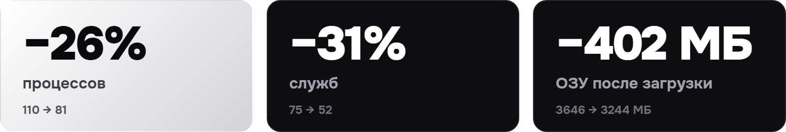
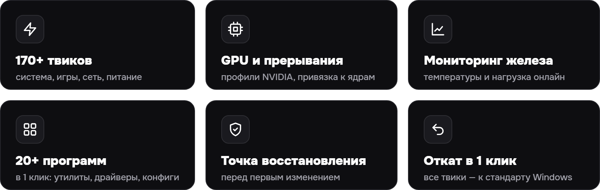
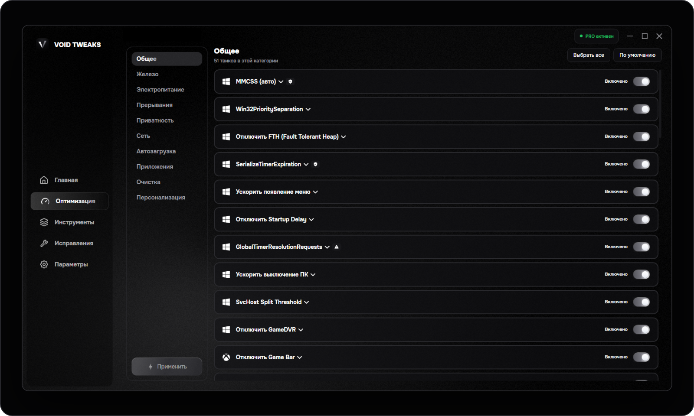

  

&nbsp;
&nbsp;
&nbsp;

 

## Честный замер

Один и тот же ПК (Ryzen 5 5600 + GTX 1650), обычная Windows 11 против Windows 11 после VOID TWEAKS. Метрики сняты через 3 минуты после загрузки Windows. В CS2 (FPS Benchmark, Dust2, 1280×960, PresentMon, 3 прогона) средний FPS вырос на **1.5%** (283 → 288), разница в 1% low — в пределах погрешности.

## Возможности

## Системные требования

- Windows 10 / 11, 64-bit (рекомендуется Windows 11)
- Права администратора
- .NET 10 Runtime — ставится автоматически
- Около 250 МБ на системном диске

## Обратная связь

Нашли ошибку? Создайте [Issue](https://github.com/voidtweaksapp/voidtweaks/issues): версия VOID TWEAKS, версия Windows, конфигурация ПК и шаги до проблемы.
Не прикладывайте в открытый Issue ключи лицензии, токены и персональные данные.

VOID TWEAKS · Windows optimization & system tuning

