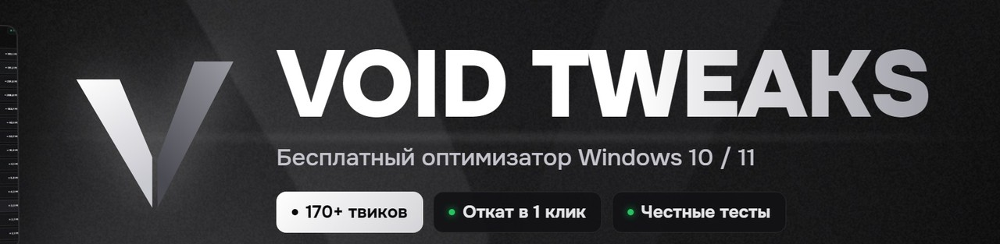

  

  

    
    
    
  

  <h3><a href="https://github.com/voidtweaksapp/voidtweaks/releases/latest/download/VOIDTWEAKSInstaller.exe">⬇ Скачать VOID TWEAKS</a></h3>
  <a href="https://voidtweaksapp.github.io/voidtweaks/">Сайт</a> · <a href="https://www.youtube.com/@VoidTweaksApp">YouTube</a> · <a href="https://t.me/disxrm">Telegram</a>

## Что это

**VOID TWEAKS** — приложение для тонкой настройки Windows: системные твики, задержка, производительность и железо в одном интерфейсе вместо разрозненных `.reg`-файлов и PowerShell-команд.

- **170+ твиков**: система, игры, GPU (включая профили NVIDIA), CPU, память, сеть, периферия, прерывания
- **Мониторинг железа** в реальном времени
- **Менеджер автозагрузки**, очистка, управление службами
- **Встроенные инструменты**: 20+ программ в один клик, конфиги для игр, драйверы
- **Безопасность**: точка восстановления перед первым изменением и **откат всех твиков одной кнопкой**

## Честный замер

Один и тот же ПК (Ryzen 5 5600 + GTX 1650), обычная Windows 11 против Windows 11 после VOID TWEAKS:

| | Stock | VOID | Разница |
|---|---:|---:|---:|
| Процессы | 110 | 81 | **−26%** |
| Службы | 75 | 52 | **−31%** |
| ОЗУ после загрузки | 3646 МБ | 3244 МБ | **−402 МБ** |
| CS2, средний FPS (3 прогона) | 283 | 288 | +1.5% |

Метрики системы сняты через 3 минуты после загрузки Windows, FPS — PresentMon на карте CS2 FPS Benchmark (Dust2, 1280×960). Разница в 1% low — в пределах погрешности.

## Системные требования

- Windows 10 / 11, 64-bit (рекомендуется Windows 11)
- Права администратора
- .NET 10 Runtime — ставится автоматически
- Около 250 МБ на системном диске

## Обратная связь

Нашли ошибку? Создайте [Issue](https://github.com/voidtweaksapp/voidtweaks/issues) и укажите версию VOID TWEAKS, версию Windows, конфигурацию ПК и шаги до проблемы.
Не прикладывайте в открытый Issue ключи лицензии, токены и персональные данные.

---

VOID TWEAKS · Windows optimization & system tuning

